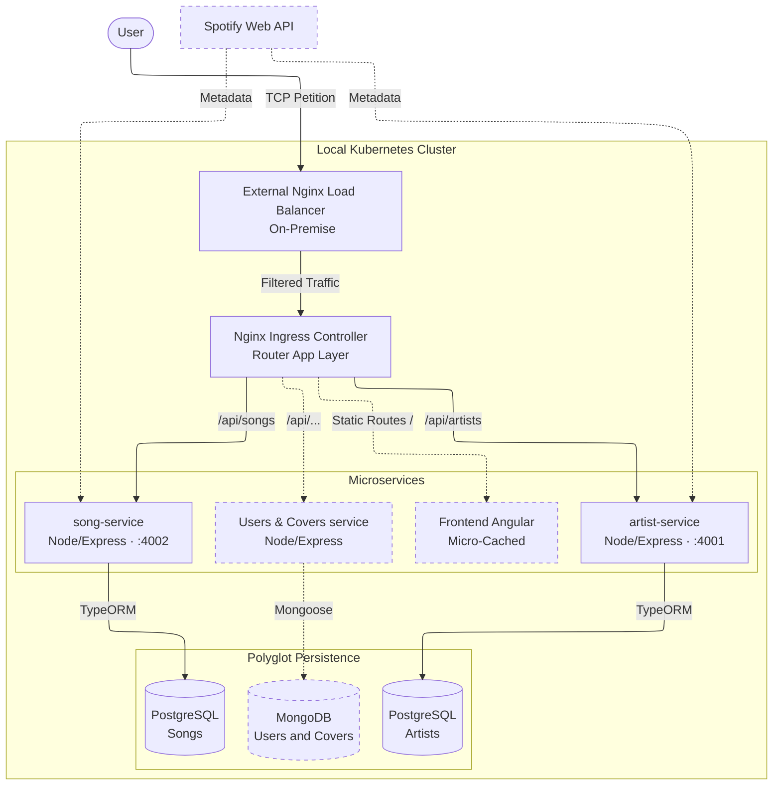
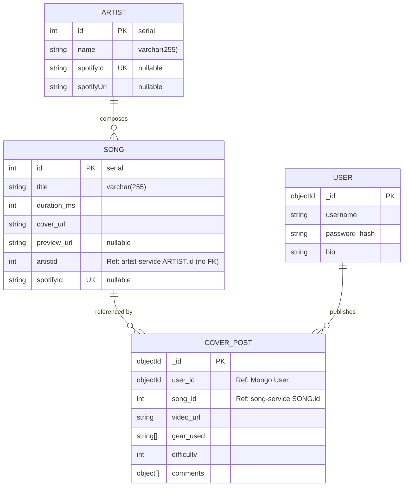

# RebelWay Guitar Gallery


*A microservices-based full-stack application initially designed as a personal guitar cover gallery, with an architecture ready to scale into a niche social media platform.*

The main goal of this project is to integrate **Kubernetes** and **Nginx** into the ecosystem, and to implement **polyglot persistence** combining **PostgreSQL** (for structured/immutable data) and **MongoDB** (for dynamic/document data) to serve different microservices within a single cohesive platform.

## Tech Stack & Technologies

*   **Frontend:** [Angular](https://angular.io) with Angular CLI, Bootstrap, and SCSS.
*   **Backend:** [Node.js](https://nodejs.org) and [Express.js](http://expressjs.com) (TypeScript).
*   **Databases (Polyglot):** 
    *   [PostgreSQL](https://www.postgresql.org/) (Relational Catalog via TypeORM).
    *   [MongoDB](https://www.mongodb.com/) (Dynamic Social Documents via Mongoose).
*   **Infrastructure & DevOps:** Docker, Kubernetes (K8s), and Nginx (Ingress/Reverse Proxy).
*   **External Integrations:** Spotify Web API (Track Metadata & Previews).
*   **Security:** JSON Web Token (JWT) and Bcrypt.js.

## Project Roadmap 

- [x] Initial system design and architecture planning (Mermaid ERD & Flowcharts).
- [x] Baseline cleanup and migration to a decoupled Client/Server structure.
- [x] Containerize PostgreSQL and MongoDB environments using Docker Compose.
- [x] Implement the Node.js artist and song microservices with PostgreSQL (Spotify mocked behind `ISpotifyService`).
- [x] Production-ready Docker images, TypeORM migrations and health checks.
- [ ] Integrate the Spotify Web API in the backend.
- [ ] Implement the Node.js Post backend with MongoDB.
- [ ] Develop the Angular frontend.
- [ ] Configure Nginx as a Reverse Proxy and API Gateway.
- [ ] Orchestrate the entire ecosystem using local Kubernetes (Minikube/Kind).

## Architecture

Target architecture. Each microservice owns its database and is built, tested and deployed independently. Dashed elements are not implemented yet.



### Service endpoints

| Service | Endpoint | Description |
|---|---|---|
| artist-service | `GET /health` | Liveness/readiness probe. `200 { status: "ok" }` or `503` if the database is not initialized |
| artist-service | `POST /api/artists` | Creates an artist (`name`, `spotifyId` mandatory) |
| artist-service | `GET /api/artists/:spotifyId` | Gets an artist by Spotify ID |
| artist-service | `POST /api/artists/spotify/:spotifyId` | Returns the artist, fetching it from Spotify and saving it if it does not exist |
| song-service | `GET /health` | Liveness/readiness probe. `200 { status: "ok" }` or `503` if the database is not initialized |
| song-service | `POST /api/songs` | Creates a song (`title`, `spotifyId`, `duration_ms`, `cover_url`, `artistid` mandatory) |
| song-service | `GET /api/songs/:spotifyId` | Gets a song by Spotify ID |
| song-service | `POST /api/songs/spotify/:spotifyId` | Returns the song, fetching it from Spotify and saving it if it does not exist |

## Data Model



**Cross-service consistency.** `SONG.artistid` is an identifier, not a foreign key: artists live in another service's database. song-service does not currently verify that the artist exists; the system accepts **eventual consistency** for now. Once the real Spotify Web API is integrated, song-service will validate the reference with a synchronous HTTP call to artist-service.

**Schema changes** are applied through TypeORM migrations (`synchronize` is always `false`).

## Backend Folder Structure

Every microservice follows the same layout:

```
services/<name>-service/
├── src/
│   ├── api/
│   │   └── spotify.controller.ts     # External integration behind ISpotifyService (mock until the real API)
│   ├── config/
│   │   └── database.ts               # TypeORM DataSource, configured only through environment variables
│   ├── migration/
│   │   └── <timestamp>-Init*.ts      # Schema migrations
│   ├── <domain>/
│   │   ├── <domain>.route.ts         # HTTP layer: endpoints, mandatory field validation, status codes
│   │   ├── <domain>.service.ts       # Business logic: orchestrates each use case
│   │   ├── <domain>.repository.ts    # Data access: the only layer that uses the TypeORM repository
│   │   ├── <domain>.model.ts         # TypeORM entity
│   │   ├── <domain>.service.spec.ts      # Unit tests (mocked dependencies)
│   │   ├── <domain>.integration.spec.ts  # Service + SQLite in-memory database
│   │   └── <domain>.e2e.spec.ts          # HTTP endpoints with supertest
│   └── app.ts                        # Express app, /health and database bootstrap
├── .env.example
├── Dockerfile                        # Multi-stage production image (build context: monorepo root)
├── package.json
└── tsconfig.json
```

## Local Development Setup

Requirements: Node.js 24 and Docker.

1. Clone the repository and install the dependencies from the root (npm workspaces):
   ```bash
   npm install
   ```
2. Create `services/artist-service/.env` and `services/song-service/.env` from their `.env.example`.
3. Start the whole backend with the **same production images** that will run in Kubernetes:
   ```bash
   docker compose up -d --build
   ```
   For each service, Compose starts its PostgreSQL, waits until it is healthy, runs the pending migrations in a one-off container and then starts the service:
   - artist-service → `http://localhost:4001` (`/health`, `/api/artists`)
   - song-service → `http://localhost:4002` (`/health`, `/api/songs`)

### Useful commands (from the root)

| Command | Description |
|---|---|
| `npm test` | Runs all the tests (`npm run test:artist` / `npm run test:song` per service) |
| `npm run build:artist` / `npm run build:song` | Compiles a service to `dist/` |
| `npm run migration:generate -w services/<name>-service -- src/migration/<Name>` | Generates a migration from the entity changes (needs a running database and the `DB_*` variables) |
| `npm run migration:run -w services/<name>-service` | Runs the pending migrations from the compiled `dist/` |

The CI runs the build and the tests with a minimum coverage of **80 %** (lines, statements, functions and branches).

### Frontend

```bash
cd client && npm install
```

Author
Alejandro Rivada
